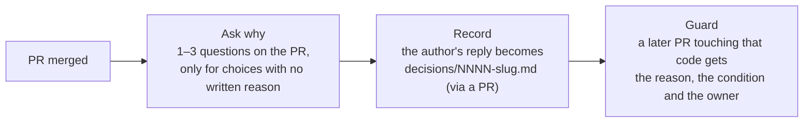

# Chesterton

**Live dashboard:** https://chesterton-aaditya-26.web.app · **Demo repo:** https://github.com/Aaditya-Nepal00/chesterton-demo

Code keeps the *what* and loses the *why*. A retry limit of 3, a pinned dependency, a 15-second timeout: each was chosen for a reason that lived in someone's head or a chat thread, and when that person moves on, the next maintainer has to guess. Changes written with AI assistants make the gap wider, because more code is merged with less discussion behind it. Chesterton runs on every merged pull request, finds the consequential choices whose reason is not written down anywhere (description, commits, review threads, linked issues, code comments), and asks the author one short question per choice. The author's one-line reply becomes a decision record in `decisions/`, quoted verbatim and linked to the evidence. When a later pull request touches that code, Chesterton posts the recorded reason, when it is safe to change, and who owns it.

The name comes from Chesterton's fence: don't remove a fence until you know why it was put up.

## How it works



1. **Merge → ask.** The `analyze_pr` workflow reads the PR, extracts decisions, checks every one for a written reason, and posts at most one comment with up to three questions. Decisions whose reason is common knowledge (dropping an end-of-life runtime, a linked security advisory) are marked self-evident and not asked about.
2. **Reply → record.** When the PR author replies, `record_answer` maps the reply to the open questions, keeps only reasons it can quote verbatim from the reply, opens a PR adding `decisions/NNNN-slug.md`, and replies on the original PR with the link.
3. **New PR → guard.** On every new commit to an open PR, `guard_pr` matches the changed lines against recorded decisions (path, plus the identifiers the decision covers, within ±3 lines) and posts or updates one informational comment. It never blocks a merge.

## Architecture

```
GitHub event ──▶ GitHub Action (python -m app.action)
                   │  routes pull_request / issue_comment / workflow_dispatch
                   ▼
                 ADK 2 graph workflow
                   ├─ deterministic nodes (fetch, signals, evidence index, matching, rendering)
                   ├─ Gemini Flash-Lite: screen the PR, judge guard matches
                   ├─ Gemini Flash: find decisions, look for a written reason, write questions, read answers
                   └─ deterministic verifier: evidence ids must exist, quoted reasons must appear verbatim
                   │  model fallback chain on daily free-tier quota
                   ▼
                 Firestore ──▶ dashboard on Firebase Hosting (reads live, read-only)
```

- **Runtime:** GitHub Actions. There is no server; each event runs one job. Chesterton writes to GitHub as its own GitHub App (installation token), never with `GITHUB_TOKEN`.
- **Agents:** [Google ADK 2](https://google.github.io/adk-docs/) graph `Workflow`s. LLM steps are ADK `Agent` nodes with Pydantic output schemas; everything that can be done in code is a plain function node. Rationale checks and guard judgments run as parallel workers (at most 2 concurrent model calls).
- **Models:** Gemini through the Gemini API, as ordered chains (`gemini-3.8-flash → 3.6-flash → 2.5-flash` and `gemini-3.5-flash-lite → 3.1-flash-lite → 2.5-flash-lite`). When a model hits its daily free-tier quota it is skipped until 00:00 UTC and the same request moves to the next model; per-minute limits are waited out; 503s are retried with backoff. If the whole chain is out of quota, the run is marked *paused*, not failed.
- **Verifier:** plain Python checks every model claim against an evidence index built from the PR. A decision must cite diff hunks that exist; a "reason found" must quote text that is actually in the cited evidence; a question may only compare to a previous value visible in the diff. Anything that fails is dropped or downgraded, and the change is recorded as a verifier note.
- **Storage:** Firestore holds analyses, question sets, decision records, guard results, backfill measurements (`backfills/{owner}__{repo}` with one item per PR) and a step-by-step trace of every run (`runs/{id}/events`, written as each step happens).
- **Dashboard:** React on Firebase Hosting, reading Firestore directly with security rules that allow reads of these collections only and deny all client writes.

### Workflows and nodes

| Workflow | Nodes (in order; `∥` = parallel, `[LLM]` = Gemini) |
|---|---|
| `analyze_pr` | `load_context` → (`compute_signals` ∥ `build_evidence`) → `join_context` → `screen_input` → `screen` [LLM, Flash-Lite] → `gate` → `extract_input` → `extract` [LLM] → `plan_rationale` → `rationale` [LLM, parallel worker per decision] → `verify` → `questions_input` → `questions` [LLM] → `verify_questions` → `render_comment` → `persist` → `post_questions`. Skips (bot, release, docs-only, nothing consequential) go to `finish_skipped`. |
| `record_answer` | `load_question_set` → `answer_input` → `parse_answer` [LLM] → `verify_answer` → `allocate_numbers` → `render_records` → `open_record_pr` → `reply_on_source_pr` → `persist`. Nothing usable goes to `finish_none`. |
| `guard_pr` | `load_pr_diff` → `load_decisions` → `match` → `judge` [LLM, Flash-Lite, parallel worker per match] → `render_guard_comment` → `upsert_comment` → `persist`. No matches goes to `finish_none` (which still clears an old guard comment). |

## Install in your repo

1. **Create a GitHub App** (Settings → Developer settings → GitHub Apps → New):
   - Webhook: off (the Action receives events, not the App).
   - Repository permissions: Contents **read & write**, Issues **read & write**, Pull requests **read & write**, Metadata read.
   - Generate a private key (`.pem`), note the App ID, and **install the App** on your repo.
2. **Firestore:** a Google Cloud project with Firestore (Native mode; the free tier is enough) and a service account with `roles/datastore.user`. Create a JSON key for it.
3. **Add secrets and a variable** to your repo (Settings → Secrets and variables → Actions):
   - Secrets: `GOOGLE_API_KEY` (Gemini API key from Google AI Studio), `GCP_SA_KEY` (the service-account JSON), `CHESTERTON_APP_ID`, `CHESTERTON_APP_PRIVATE_KEY` (the full `.pem` contents).
   - Variable: `GCP_PROJECT` (your Google Cloud project id).
4. **Copy [`examples/chesterton.yml`](examples/chesterton.yml)** to `.github/workflows/chesterton.yml`.

Optional inputs: `model-main-chain` and `model-screen-chain` (comma-separated, in fallback order). You can also run Chesterton by hand from the Actions tab (`workflow_dispatch` with `mode` = `analyze` or `guard` and a PR number).

## Local development (PowerShell)

Prereqs: Python 3.12 via [uv](https://docs.astral.sh/uv/), Node 20+. Copy `.env.example` to `.env` (or set the same variables in the environment; `.env` is optional). Firestore uses Application Default Credentials (`gcloud auth application-default login`) or `GOOGLE_APPLICATION_CREDENTIALS`.

```powershell
cd backend
uv sync

# Analyze any public PR (read-only, never posts)
uv run python scripts/analyze_pr.py encode/httpx 3592 --no-persist
uv run python scripts/list_prs.py pallets/flask --limit 30

# Measure the why-gap on a public repo's last N merged PRs (read-only, never posts).
# --dry-run makes 0 Gemini calls and prints the estimated calls; the real run never
# spends more than --budget-calls and continues with --resume after a stop.
uv run python scripts/backfill.py pallets/flask --limit 22 --budget-calls 40 --dry-run
uv run python scripts/backfill.py pallets/flask --limit 22 --budget-calls 40

# Run the Action's code path locally (writes only to GITHUB_DEMO_REPO, as the App)
uv run python scripts/run_event.py --kind analyze --repo owner/demo --pr 1 --dry-run
uv run python scripts/run_event.py --kind record  --repo owner/demo --pr 1 --comment-id 123
uv run python scripts/run_event.py --kind guard   --repo owner/demo --pr 2

# Watch a run fill in on the dashboard without using any Gemini quota (fake model)
uv run python scripts/selftest_live_trace.py

# Dashboard (http://localhost:5173); needs frontend/.env.local (see frontend/.env.example)
cd ../frontend
npm install
npm run dev
```

Maintenance scripts (all dry-run by default, `--apply` to change anything): `scripts/backfill_fields.py`, `scripts/migrate_quota_status.py`, `scripts/rerender_questions.py`, `scripts/cleanup_demo_data.py`.

## Tests

```powershell
cd backend
uv run pytest -q      # unit tests; no network: Gemini and Firestore are faked
uv run ruff check .
cd ../frontend
npm run build         # type-check + production build
```

The tests cover the deterministic parts (signals, evidence index, verifier, symbol matching, decision numbering, markers, event routing, config) and the workflows themselves with fake models: model fallback on daily quota, paused runs, retries, and trace events streamed before a run finishes.

## Limitations

- **Free-tier quota.** On the free Gemini API tier each model allows about 20 requests a day. One analysis uses up to 6 calls (1 screen + up to 5 main), so a busy repo needs a paid key or will see paused runs until 00:00 UTC. The fallback chain stretches the quota but does not remove the limit.
- **The verifier checks quotes, not meaning.** It guarantees that a quoted reason really appears in the cited text, but not that the text is a good reason. A verbatim but weak sentence ("based on X's comment, merging this") can still count as a partial reason.
- **Decisions are found by a model.** It can miss a decision or ask about something that was not one. Questions are limited to three per PR to keep the cost of a wrong guess low.
- **Guard matching is lexical.** It matches file paths and identifiers near changed lines; a change that alters a decision through different code (a renamed constant, a value moved to another file) is not caught.
- **English only.** Prompts, questions and answer parsing assume English.
- **Answers are read from PR conversation comments**, not from inline review threads.
